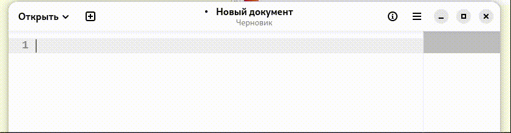

# WaylandSwitcher

Переключатель раскладки клавиатуры и корректор ввода для Linux на Wayland.
Исправляет текст, набранный не в той раскладке (`ghbdtn` → «привет»), — как
набираемый прямо сейчас, так и уже выделенный в любом приложении.



## Возможности

- **Коррекция набранного текста.** Клавиша коррекции (по умолчанию `Pause`)
  стирает набранное и повторяет те же нажатия в другой раскладке.
- **Коррекция выделенного текста.** Выделите текст мышью, `Shift`+стрелки,
  `Shift`+`Home`/`End`/`PageUp`/`PageDown` или `Ctrl`+`A` и нажмите ту же
  клавишу: текст будет перекодирован между EN (QWERTY) и RU (ЙЦУКЕН) и
  вставлен на место выделения. Содержимое буфера обмена при этом сохраняется.
- **Переключение раскладки** выбранной вами клавишей или сочетанием.
- Работает как systemd-служба, не зависит от приложения и от рабочего стола.

## Клавиши коррекции

| Нажатие | Действие |
|---|---|
| `Pause` | исправить последнее слово (до ближайшего пробела слева) |
| `Shift` + `Pause` | исправить всю набранную фразу (после последнего `Enter`) |
| `Shift` (с удержанием) + `Pause` | то же, плюс смена регистра символов |
| `Pause` при выделенном тексте | перекодировать выделение |

Режим `reverse-mode=true` в конфиге меняет местами «слово» и «фразу».

## Требования

- Linux с Wayland (проверено на Fedora, GNOME); X11 поддерживается через
  `xclip` или `xsel`.
- Права root: служба читает `/dev/input/*` и создаёт устройство через
  `/dev/uinput`.
- Для коррекции выделенного текста — `wl-clipboard` (Wayland) либо `xclip`/`xsel` (X11).
- Для сборки — Nim 2.0 или новее и `gcc`.

## Установка

```bash
nim c -d:release WaylandSwitcher.nim
./reinstall.sh
```

`reinstall.sh` копирует собранный бинарник в `/usr/local/bin/wayland-switcher`,
создаёт systemd-юнит, при отсутствии конфига запускает настройку, включает
автозапуск, запускает службу и проверяет, что она работает. Тот же сценарий
используется для обновления.

Настройка вручную (клавиатура, клавиша переключения, клавиша коррекции):

```bash
sudo wayland-switcher -c
sudo systemctl restart wayland-switcher
```

## Файл конфигурации

`/etc/wayland-switcher/default.conf`, формат `ключ=значение`:

| Параметр | Назначение |
|---|---|
| `keyboard` | устройство клавиатуры, например `/dev/input/event4` |
| `mouse` | устройство мыши, обычно `/dev/input/mice` |
| `layout-switch-key` | скан-код клавиши переключения раскладки или два кода через `+` |
| `replace-key` | скан-код клавиши коррекции (`119` — Pause) |
| `reverse-mode` | `true` меняет местами «слово» и «фразу» |
| `delay` | пауза между событиями виртуальной клавиатуры, мс (0–5000) |
| `clipboard-tool` | `auto`, `wayland`, `xclip` или `xsel` |

## Командная строка

```
wayland-switcher [-i | -u | -c | -r | -d | -o | -h]
```

`-i` создать юнит, `-u` удалить юнит, `-c` настроить, `-r` запустить,
`-d` запустить в терминале с подробным логом, `-o` классический демон без
systemd, `-h` справка.

## Диагностика

```bash
systemctl status wayland-switcher
journalctl -u wayland-switcher -b
sudo systemctl stop wayland-switcher && sudo wayland-switcher -d
```

В режиме `-d` видно каждое событие клавиатуры и каждый шаг коррекции.

## Удаление

```bash
sudo systemctl disable --now wayland-switcher
sudo wayland-switcher -u
sudo systemctl daemon-reload
sudo rm -f /usr/local/bin/wayland-switcher
sudo rm -rf /etc/wayland-switcher
```

## Устройство проекта

```
WaylandSwitcher.nim   точка входа: параметры командной строки, режимы запуска
reinstall.sh          установка бинарника и службы
src/
  types.nim           типы и константы
  core.nim            состояние потоков, ожидание ввода, логирование
  shellquote.nim      экранирование для shell и systemd
  config.nim          загрузка и запись конфигурации
  configure.nim       интерактивная настройка
  install.nim         systemd-юнит
  buffer.nim          анализ буфера нажатий
  layout.nim          перекодировка EN <-> RU
  vkbd.nim            виртуальная клавиатура (uinput)
  clipboard.nim       буфер обмена сессии пользователя
  selection.nim       коррекция выделенного текста
  mouse.nim           поток мыши: клик или протаскивание
  daemon.nim          главный рабочий цикл
docs/                 подробное руководство пользователя
```

Подробности — в [руководстве](docs/Установка__настройка_и_работа.md).

## Лицензия

MIT, см. [LICENSE](LICENSE).
